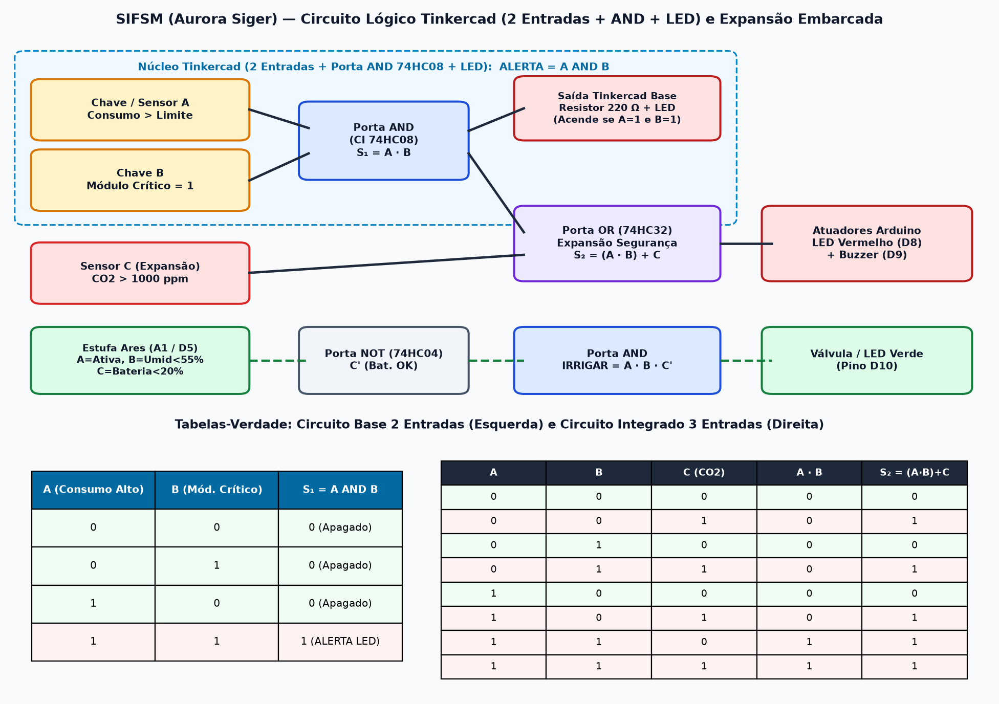
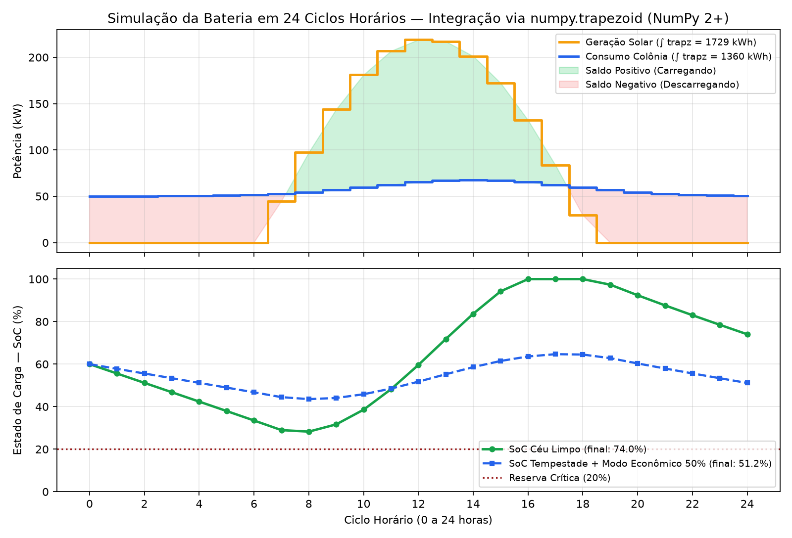
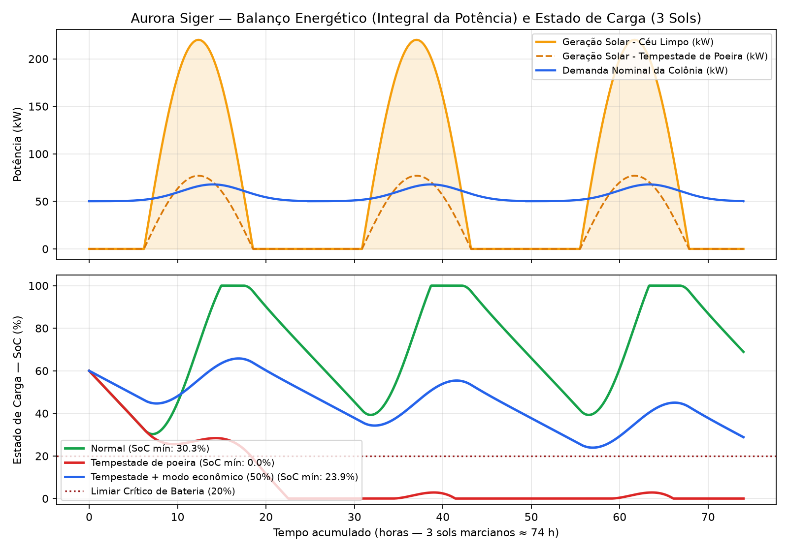
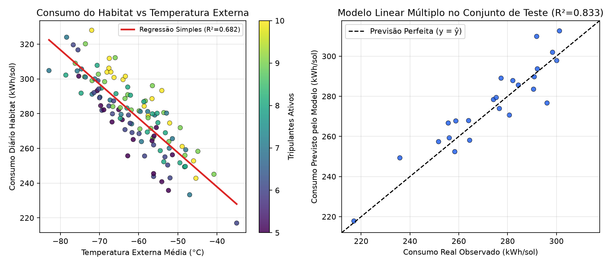
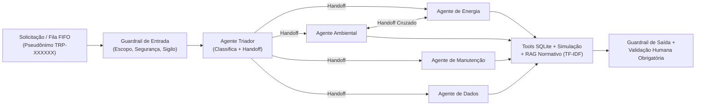
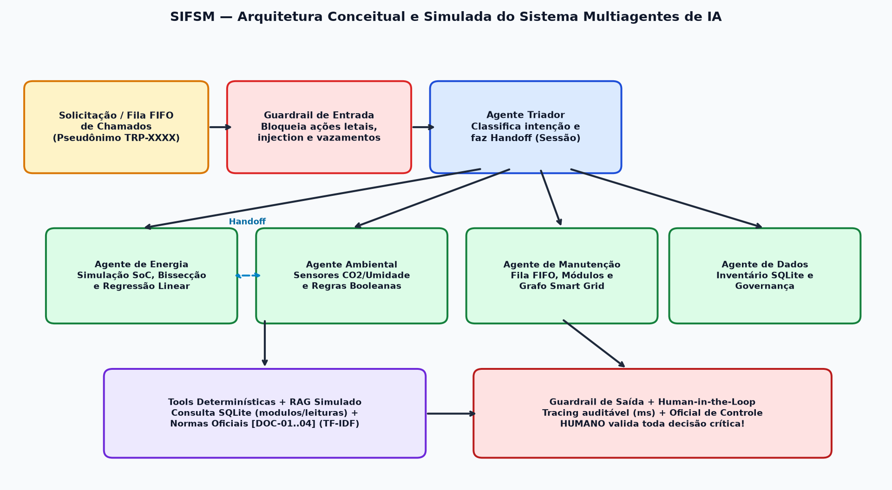

# Relatório Técnico — Sistema Integrado de Futuro Sustentável em Marte (SIFSM)

**Projeto:** Atividade Integradora — Fase 7 (Missão Aurora Siger)  

| Integrante | RM |
|---|---|
| João Victor Viana Feitosa | 573217 |
| Luis Gustavo Ribeiro Andrade | 569147 |
| Matheus de Carvalho Teodoro | 572855 |
| Pedro César Fernandes de Brito | 573965 |
| Gabriel Coutinho Barcelos | 573211 |

---

## 1. Contexto da Solução e Arquitetura Integrada

Com a evolução da base **Aurora Siger** em Marte, módulos vitais — **Habitat Alfa**, **Estufa Ares**, **Laboratório Gale**, **Módulo Médico**, **Comunicações Olympus**, **Depósito Jezero**, **Usina Solar Hélio** e **Centro de Controle** — passaram a exigir coordenação unificada. O **SIFSM (Sistema Integrado de Futuro Sustentável em Marte)** conecta banco de dados relacional, tratamento de exceções, regras booleanas e circuitos embarcados, estruturas de dados clássicas, simulação matemática contínua, regressão linear múltipla, sistema multiagentes com guardrails/RAG, análise de arquitetura computacional heterogênea e governança socioambiental.

```
+-----------------------------------------------------------------------------------+
|                        CAMADA ANALÍTICA E COGNITIVA (SIFSM)                       |
|  Banco SQL (CRUD + Pilha Undo)  |  Simulação Integral + PID  |  Regressão Linear  |
|  Multiagentes IA (Triador, Energia, Ambiental, Manutenção, Dados + Guardrails/RAG)|
+-----------------------------------------+-----------------------------------------+
                                          |
+-----------------------------------------v-----------------------------------------+
|                    CAMADA DE ESTRUTURAS E CONTROLE OPERACIONAL                    |
|  Tabela Hash (Sensores O(1)) | Fila FIFO (Chamados) | Heap (Alertas) | Grafo Rede |
|  Regras Booleanas em Software (Python)  <===>  Portas Lógicas / Arduino Embarcado |
+-----------------------------------------+-----------------------------------------+
                                          |
+-----------------------------------------v-----------------------------------------+
|                         CAMADA FÍSICA SIMULADA DA COLÔNIA                         |
|  Usina Solar Hélio + Banco de Baterias (1200 kWh) + Sensores + Atuadores Locais   |
+-----------------------------------------------------------------------------------+
```

---

## 2. Organização dos Dados, Banco Relacional e CRUD (`sifsm/banco.py` e `script_banco.sql`)

O modelo relacional possui **5 tabelas normalizadas** com restrições de integridade (`PRIMARY KEY`, `FOREIGN KEY`, `UNIQUE`, `NOT NULL` e `CHECK`):

1. **`modulos`**: cadastro das unidades físicas (`nome`, `tipo`, `critico`, `status`, `consumo_nominal_kw`);
2. **`sensores`**: instrumentos vinculados aos módulos (`codigo`, `modulo_id`, `tipo`, `unidade`, `limite_min`, `limite_max`) com `ON DELETE RESTRICT`;
3. **`leituras`**: séries históricas por dia marciano (`sensor_id`, `sol`, `valor`, `registrado_em`);
4. **`solicitacoes`**: chamados da tripulação registrados sob pseudônimo `TRP-XXXXXX` (`tripulante`, `modulo_id`, `descricao`, `prioridade`, `status`);
5. **`alertas`**: eventos gerados pelas regras booleanas (`modulo_id`, `nivel`, `regra`, `mensagem`).

### Conexão Python e Tratamento de Erros
A classe `BancoAurora` utiliza `sqlite3` (banco relacional SQL equivalente ao Oracle, garantindo portabilidade imediata sem instalação de servidor; o DDL equivalente para **Oracle Database / `oracledb`** também está documentado ao final de `script_banco.sql`).  
Todas as operações **CRUD** (`inserir`, `listar`/`obter`, `atualizar`, `excluir`) usam consultas parametrizadas (`?`) + lista branca de esquema contra *SQL Injection*, transações explícitas (`commit`/`rollback`) e blocos completos `try / except / else / finally`:
- **`try`**: abre conexão, lê script ou executa comando SQL;
- **`except`**: captura `sqlite3.IntegrityError`, `sqlite3.Error`, `FileNotFoundError` e `ValueError` no menu, traduzindo falhas técnicas (ex.: violação de chave estrangeira ao tentar apagar um módulo que possui sensores) para mensagens claras;
- **`else`**: efetiva o `commit()` ou a carga inicial apenas quando nenhuma exceção ocorreu;
- **`finally`**: garante `PRAGMA foreign_keys = ON` e o fechamento seguro da conexão (`banco.fechar()`) ao encerrar o sistema.

---

## 3. Lógica Booleana, Circuitos Digitais e Automação Embarcada (`sifsm/logica.py`, `circuito_logico.png`, `circuito_arduino.ino`)

As decisões críticas foram implementadas tanto em expressões booleanas Python quanto pela composição pura de portas digitais (`AND`, `OR`, `NOT`), comprovando equivalência matemática pelas tabelas-verdade:

| Regra do Sistema | Expressão Booleana | Álgebra de Boole | Implementação em Portas / Hardware |
|---|---|---|---|
| **Alerta Base (Tinkercad 2 entradas)** | `consumo_alto AND critico` | $S_1 = A \cdot B$ | 2 chaves + `74HC08` (AND) $\rightarrow$ Resistor $220\,\Omega$ + LED |
| **Alerta Integrado (`classificar_risco`)** | `(consumo_alto AND critico) OR falha_seg` | $S_2 = (A \cdot B) + C$ | `74HC08` (AND) $\rightarrow$ `74HC32` (OR) $\rightarrow$ LED Vermelho + Buzzer |
| **Irrigação Estufa** | `ativa AND umidade_baixa AND (NOT bat_crit)` | $S = A \cdot B \cdot \overline{C}$ | `74HC04` (NOT) + 2 portas AND $\rightarrow$ Válvula de Gotejamento |
| **Iluminação LED** | `presenca AND luz_baixa` | $S = A \cdot B$ | 1 porta AND $\rightarrow$ Fita LED do corredor |
| **Bloqueio Seguro** | `falha_seguranca OR sensor_invalido` | $S = A + B$ | 1 porta OR (*fail-safe* se leitura for `NaN`/fora da faixa física) |
| **Sinalização** | `manutencao OR temp_fora_faixa` | $S = A + B$ | 1 porta OR $\rightarrow$ Sinalizador Amarelo |

A função `classificar_risco()` classifica cada módulo em risco `ALTO`, `MEDIO` ou `BAIXO`. O arquivo `circuito_logico.png` ilustra tanto o núcleo de 2 entradas (`ALERTA = A AND B`) quanto a expansão embarcada e as respectivas tabelas-verdade, enquanto `circuito_arduino.ino` traz o firmware C++ pronto para o **Tinkercad Circuits**.



---

## 4. Estruturas de Dados Aplicadas a Sistemas Complexos (`sifsm/estruturas.py`)

Cada estrutura foi selecionada conforme a complexidade algorítmica e a semântica operacional do problema:

1. **Fila FIFO (`FilaAtendimento` via `collections.deque`)**: organiza solicitações cotidianas da tripulação. Inserção e remoção em $O(1)$, garantindo justiça de atendimento por ordem de chegada.
2. **Pilha LIFO (`PilhaHistorico`)**: armazena o estado anterior de cada `INSERT`, `UPDATE` e `DELETE` do CRUD em $O(1)$, permitindo **desfazer** erros operacionais em ordem inversa.
3. **Dicionário Python (`criar_indice_sensores` / `buscar_sensor`) e Tabela Hash (`TabelaHash` com função *djb2*, encadeamento separado e *rehash* em fator de carga $> 0,75$)**: indexam sensores por código (`CNS-HAB-01`, `CO2-LAB-01`) para busca em tempo médio $O(1)$ sem varredura linear, demonstrando tanto o uso idiomático de `dict` quanto o funcionamento interno de uma tabela hash.
4. **Árvore Binária / Heap Mínimo (`FilaPrioridadeAlertas` via `heapq`)**: prioriza alertas por gravidade (Nível 1 Crítico $\rightarrow$ Nível 2 Atenção $\rightarrow$ Nível 3 Informativo), extraindo sempre a maior emergência na raiz em $O(\log n)$.
5. **Grafo Ponderado (`GrafoEnergia` em lista de adjacência)**: modela a *Smart Grid* elétrica da colônia (arestas ponderadas pela perda percentual nos cabos). Aplica **BFS** para verificar conectividade, **Dijkstra** para achar a rota de menor perda elétrica (ex.: Usina Solar Hélio $\rightarrow$ Módulo Médico com perda acumulada de `4,2%`) e análise de **pontos únicos de falha** (`Banco de Baterias`, `Centro de Controle` e `Habitat Alfa`).
6. **Vetores/Listas (`list`)**: armazenam séries temporais equiespaçadas da simulação com acesso indexado $O(1)$ e alta localidade espacial de memória.

---

## 5. Simulação Computacional e Integração Matemática (`sifsm/simulacao.py` e `simulacao_computacional.py`)

Considerando a duração do sol marciano ($T_{\text{sol}} = 24,66\text{ h}$, janela diurna $D = 12,33\text{ h}$ e potência solar máxima $P_{\max} = 220\text{ kW}$):

1. **Simulação Discreta de 24 Ciclos Horários com `numpy.trapz` (`simular_bateria_24_ciclos`)**:
   Ao longo de 24 ciclos de $1\text{ h}$ (`0..24`), a integração trapezoidal via NumPy (`numpy.trapz` / `numpy.trapezoid`) contabiliza `1729,3 kWh` gerados contra `1401,5 kWh` consumidos na carga base (`1360 kWh` na carga ativa de `56,5 kW`), elevando o `SoC` de `60,0%` para `74,0%` em céu limpo (e mantendo `51,2%` em tempestade com modo econômico de `50%`).
2. **Cálculo Integral Analítico vs Numérico (Trapézio e 1/3 de Simpson)**:
   $$E_{\text{sol}} = \int_{t_0}^{t_0+D} P_{\max}\sin\!\left(\frac{\pi(t-t_0)}{D}\right)dt = \frac{2 P_{\max} D}{\pi} \approx 1726,89\text{ kWh/sol}$$
   Com apenas $n = 16$ subintervalos, a regra do Trapézio apresenta erro de `0,3215%`, enquanto Simpson atinge erro de `0,00083%` (convergência $O(h^4)$). A **média de função** fornece a potência solar média diária $\overline{P} = \frac{1}{T_{\text{sol}}}\int_0^{T_{\text{sol}}} P(t)\,dt = 70,0\text{ kW}$.
3. **Dinâmica Multissol do Estado de Carga da Bateria ($1200\text{ kWh}$) e Método da Bissecção**:
   Integrando $E(t) = E(0) + \int_0^t \eta\,[P_{\text{ger}}(\tau) - P_{\text{carga}}(\tau)]\,d\tau$ ao longo de 3 sols:
   - **Céu limpo**: `SoC` mínimo de `30,3%`, final de `68,9%` e excedente de `663 kWh` (aproveitável para cargas computacionais em lote);
   - **Tempestade de poeira (`-65%` de irradiância)** sem reação: colapso da bateria (`SoC = 0%`, déficit de `1694 kWh`);
   - **Tempestade + Modo Econômico (`50%`)**: guiado pelo método da **bissecção** (que determinou teto seguro de `51%` da carga nominal), mantém `SoC` mínimo em `23,9%` (acima do limiar crítico de `20%`, com déficit zero).
4. **Convolução Discreta 1D em Sensores**: filtro de média móvel ($k = 5$) sobre o sensor externo de temperatura reduziu o erro quadrático médio (RMSE) do ruído de `2,94 °C` para `1,33 °C` (`-55%` de ruído).
5. **Controle com Derivadas e Integrais (PID Térmico)**: no aquecimento do Habitat Alfa ($21\text{ °C}$), o controlador $u(t) = K_p e(t) + K_i \int e\,dt + K_d \frac{de}{dt}$ manteve erro médio em regime de **`0,20 °C`** com **0 comutações bruscas**, contra **`82`** chaveamentos liga/desliga do termostato convencional (erro médio de `0,28 °C`), preservando a vida útil dos atuadores em Marte.





---

## 6. Modelagem Linear Aplicada à Tomada de Decisão (`sifsm/regressao.py` e `dados_aurora_siger.csv`)

Sobre a base histórica simulada de 120 sols (`dados_aurora_siger.csv`, contendo uma falha proposital de leitura no sol 57 descartada automaticamente na limpeza):

- **Análise Exploratória e Correlação de Pearson ($r$)**:
  - `temperatura_externa_c`: média `-61,5 °C`, $r = -0,835$ (forte correlação negativa: quanto mais frio o exterior, maior o gasto térmico de aquecimento);
  - `tripulantes_ativos`: média `7,5`, $r = +0,270$ (correlação positiva moderada: suporte metabólico, água e uso interno);
  - `irradiancia_w_m2`: $r = +0,088 \approx 0$ (afeta a *geração* da usina, não a *demanda* interna do habitat — excluída do modelo por parcimônia).
- **Comparação no Conjunto de Teste (divisão 80% treino / 20% teste, ajuste por Mínimos Quadrados $(X^T X)\beta = X^T y$)**:
  - **Regressão Simples**: $\widehat{\text{consumo}} = 158,918 - 1,973 \cdot T_{\text{ext}}$ $\rightarrow$ $\text{MAE} = 9,58\text{ kWh}$, $\text{RMSE} = 11,78\text{ kWh}$, $R^2 = 0,682$;
  - **Regressão Múltipla**: $\widehat{\text{consumo}} = 116,990 - 2,082 \cdot T_{\text{ext}} + 4,674 \cdot N_{\text{trip}}$ $\rightarrow$ $\text{MAE} = 6,86\text{ kWh}$, $\text{RMSE} = 8,55\text{ kWh}$, $R^2 = 0,833$ (`+0,150` de ganho explicativo).
- **Interpretação e Diagnóstico**: cada `1 °C` de queda na temperatura externa eleva o consumo do habitat em `~2,08 kWh/sol`; cada tripulante ativo adiciona `~4,67 kWh/sol`. O fator de inflação de variância entre os preditores é $\text{VIF} = 1,01 < 5$, descartando multicolinearidade.



---

## 7. Sistemas Multiagentes e Integração Segura de IA (`sifsm/agentes.py`)

A arquitetura multiagentes (`SistemaMultiagentesAurora`) demonstra IA controlada em sistemas críticos:
- **Guardrail de Entrada**: bloqueia *prompt injection*, comandos destrutivos (ex.: desligar suporte à vida ou apagar tabelas), tentativas de quebrar o sigilo dos pseudônimos `TRP-XXXXXX` e consultas fora do escopo da colônia;
- **Agente Triador + Handoff**: roteia a solicitação para **`AgenteEnergia`**, **`AgenteAmbiental`**, **`AgenteManutencao`** ou **`AgenteDados`** e realiza *handoff* entre especialistas (ex.: ao detectar irrigação pendente na estufa, o `AgenteAmbiental` consulta o `AgenteEnergia` para confirmar se o `SoC` da bateria permite irrigar);
- **Ferramentas Determinísticas (Tools) + RAG**: números vêm sempre de funções Python exatas sobre o SQLite e simuladores, enquanto o buscador **RAG** (TF-IDF) cita as normas oficiais da missão (`DOC-ENERGIA-01` a `DOC-ETICA-04`);
- **Triador Automático na Fila FIFO (`processar_fila_chamados`)**: desenfileira os chamados da tripulação em ordem de chegada, aplica verificação de segurança e realiza *handoff* automático para o especialista correspondente, marcando chamados urgentes (prioridade $\le 2$) para validação humana;
- **Sessão, Tracing e Guardrail de Saída**: preserva histórico por `Session ID`, audita a latência em milissegundos de cada etapa e exige **Supervisão Humana Obrigatória (*Human-in-the-Loop*)** antes de qualquer atuação física. O módulo também mapeia a solução para fluxos **Low-Code/No-Code** (Webhooks $\rightarrow$ Guardrail $\rightarrow$ Router $\rightarrow$ Especialistas/Tools/RAG $\rightarrow$ Aprovação Humana).





---

## 8. Arquiteturas Modernas, Memória e Computação Heterogênea (`sifsm/arquitetura.py`)

Aplicando o **Modelo Roofline** (intensidade operacional $I = \text{FLOP}/\text{Byte}$) às cargas do SIFSM:
- **`logica.py` / Sensores $\rightarrow$ MCU/ASIC de borda (`0,15 W`)**: monitoramento em tempo real sem manter servidores de `65 W` acordados;
- **`banco.py` + `estruturas.py` $\rightarrow$ CPU Multicore**: código rico em desvios condicionais e ponteiros (*memory-bound*, $I = 0,62\text{ FLOP/B}$), beneficiado pelas caches SRAM `L1/L2/L3`;
- **`simulacao.py` + `regressao.py` $\rightarrow$ GPU**: paralelismo massivo SIMD/SIMT (*compute-bound*, $I = 75\text{ FLOP/B}$) para milhares de cenários Monte Carlo e matrizes;
- **`agentes.py` (Inferência/RAG) $\rightarrow$ NPU (`15 W`)**: alta eficiência em `TOPS/Watt` para consultas contínuas da tripulação;
- **Reajuste de modelos em lote $\rightarrow$ TPU com Chiplets + HBM**: memória HBM empilhada reduz o **gargalo de Von Neumann** (custo energético de mover dados entre DRAM e ALU), sendo agendada apenas ao meio-dia marciano para aproveitar o excedente solar (`~663 kWh`). A distribuição heterogênea reduz o consumo computacional estimado em **`97,5%`** frente à execução exclusiva em CPU.

---

## 9. Sustentabilidade, Cidadania Digital e Impacto Socioambiental (`sifsm/analise.py`)

O protótipo articula diretamente tecnologia e responsabilidade humana em 8 frentes:
1. **Integração em 3 camadas (Física, Controle e Analítica)** para evitar desperdício energético e hídrico;
2. **Simulação preventiva** para dimensionar cortes seguros antes de tempestades reais;
3. **Smart Grid resiliente** guiada por teoria dos grafos para proteger módulos vitais;
4. **Cidadania digital e *Privacy by Design***: função `pseudonimizar_tripulante()` aplica hash SHA-256 com sal (`TRP-XXXXXX`), evitando vigilância nominal sobre os colonos;
5. **Proteção contra abusos na economia de dados**: guardrails impedem desanonimização ou uso punitivo de dados ambientais/médicos;
6. **Sustentabilidade digital de data centers e IA**: uso de NPUs econômicas e agendamento solar de TPUs;
7. **Inovação responsável e supervisão humana**: nenhuma recomendação algorítmica substitui a validação ética e técnica da equipe;
8. **Justiça e inclusão**: fila FIFO imparcial para demandas cotidianas combinada a critérios técnicos transparentes (Heap) para emergências.

---

## 10. Limitações do Protótipo e Melhorias Futuras

- **Limitações atuais**: uso de dados e sensores simulados; modelo solar sem variação sazonal orbital completa de Marte nem degradação química das células de bateria; regressão linear assumindo relação estritamente linear; RAG lexical local sem LLM externo em nuvem.
- **Melhorias futuras**: integração com hardware físico (ESP32/Arduino via MQTT), banco Oracle corporativo em produção, controle preditivo baseado em modelo (MPC) acoplando previsão meteorológica à malha térmica e interface gráfica web para o Centro de Controle da Aurora Siger.
